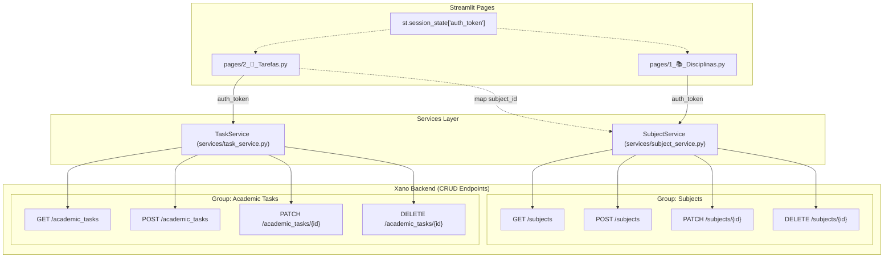

# Design: Sincronização das Páginas de Disciplinas e Tarefas com Xano

## Architecture & Integration Strategy

A arquitetura do EduTrack AI adota o padrão de separação de responsabilidades (Service Layer):
- **Frontend (Streamlit):** As páginas em `pages/` lidam estritamente com a renderização da interface gráfica, captura de eventos de usuário e manipulação de `st.session_state`.
- **Camada de Serviços (`services/`):** Encapsula chamadas HTTP REST para o backend Xano, serialização/desserialização de JSON, cabeçalhos de autenticação (`Authorization: Bearer <token>`) e mecanismos de contingência (fallback) para desenvolvimento offline.
- **Backend (Xano):** Endpoints RESTful já criados na Tarefa 12 (`/subjects` e `/academic_tasks`) sob os grupos `Subjects` e `Academic Tasks`, com autenticação JWT e isolamento de tenant por `user_id`.

---

## Detalhamento das Alterações

### 1. `services/subject_service.py`
- Adicionar ou refinar métodos para aceitar o token JWT diretamente (ex: `list_subjects(token=...)`, `create_subject(token=..., name=..., teacher=..., hours=...)`, `update_subject(token=..., id=..., ...)`, `delete_subject(token=..., id=...)`).
- Utilizar `URL_BASE_ALT` / `XANO_API_URL` carregado automaticamente do arquivo `.env`.
- Mapear os campos da tabela Xano: `name` (obrigatório), `teacher` (opcional), `hours` (opcional).

### 2. `services/task_service.py`
- Criar a classe `TaskService` espelhando a estrutura robusta do `SubjectService`:
  - `list_tasks(token=..., subject_id=..., status=...)`: consulta `GET /academic_tasks`.
  - `create_task(token=..., subject_id=..., title=..., description=..., due_date=..., status=...)`: envia `POST /academic_tasks`.
  - `update_task(token=..., task_id=..., **fields)`: envia `PATCH /academic_tasks/{id}`.
  - `delete_task(token=..., task_id=...)`: envia `DELETE /academic_tasks/{id}`.
- Manter lista de dados fallback in-memory para resiliência quando o token ou conexão não estiverem disponíveis.

### 3. Preservação Visual de `pages/1_📚_Disciplinas.py`
- A estrutura visual deve ser **rigorosamente mantida**:
  - `st.set_page_config(page_title="Disciplinas", page_icon="📚")`
  - `st.title("Gestão de Disciplinas")`
  - Abas: `tab_lista, tab_novo = st.tabs(["📋 Listar", "➕ Nova Disciplina"])`
  - Em `tab_novo`:
    - `st.subheader("Cadastrar Nova Matéria")`
    - `with st.form("form_disciplina"):`
      - `nome = st.text_input("Nome da Disciplina")`
      - `professor = st.text_input("Nome do Professor")`
      - `dia_semana = st.selectbox("Dia da Aula", ["Seg", "Ter", "Qua", "Qui", "Sex"])`
      - `submitted = st.form_submit_button("Salvar")`
    - Ao submeter: chama `subject_service.create_subject(...)`, exibindo `st.success(...)` com os dados reais salvos no Xano.
  - Em `tab_lista`:
    - Substitui a tabela estática com `st.dataframe(...)` alimentado pela lista retornada de `subject_service.list_subjects(token)`.
    - Apresenta colunas `"Nome"`, `"Professor"` e detalhes correspondentes aos registros reais.
    - Seções sutis/expansíveis para atualizar e remover disciplinas sem quebrar a harmonia visual.

### 4. Preservação Visual de `pages/2_📝_Tarefas.py`
- A estrutura visual deve ser **rigorosamente mantida**:
  - `st.title("Minhas Tarefas")`
  - `col1, col2 = st.columns([3, 1])`
  - `search = st.text_input("Buscar tarefa...", placeholder="Ex: Estudar Pandas")`
  - `filtro = st.selectbox("Status", ["Todas", "Pendente", "Concluída"])`
  - `st.markdown("---")`
  - Expander por tarefa:
    - `with st.expander(f"📌 {title} (Clique para ver)", expanded=...):`
      - `st.write(f"**Disciplina:** {subject_name}")`
      - `st.write(f"**Prazo:** {due_date}")`
      - `is_done = st.checkbox("Marcar como Concluída", value=..., key=f"task_{task_id}")`
      - Ao alterar o checkbox: dispara `task_service.update_task(..., status="completed" if is_done else "pending")` e reflete no Xano.
    - Opções integradas de cadastro de nova tarefa e exclusão sem alterar o estilo visual da página.

---

## Segurança e Tratamento de Erros
- Caso o usuário não esteja logado (`st.session_state.get("auth_token") is None`), exibir um aviso discreto informando que para visualizar e persistir seus dados no servidor Xano é necessário fazer login na página de Perfil, operando em modo de demonstração/fallback enquanto não autenticado.
- Todas as requisições autenticadas enviam o header `Authorization: Bearer <token>` para garantir a integridade dos dados no Xano.

